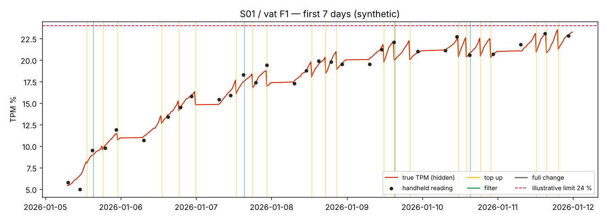

# FryWise — Frying-Oil Decision Support (Demo Prototype)

> **DEMO MODEL — SYNTHETIC DATA — ILLUSTRATIVE PARAMETERS.**
> Not for food-safety, oil-discard or other live operational decisions. Limits and procedures must come from the
> restaurant operator and food-safety specialists. FryWise is an independent concept and is not affiliated with or
> endorsed by any restaurant chain.

FryWise turns everyday point-of-sale (POS) data into frying-oil decisions for quick-service restaurants.
It maps every sold item to the kilograms of food that went into each fryer, forecasts how the oil's
**Total Polar Materials (TPM %)** will develop, and gives the operator one instruction per vat —
*continue, filter, top up or change the oil* — plus when to measure again.



---

## How it works

```
Tablet UI (Google AI Studio, React)          ← designed in Google Stitch
        │  button commands only: TIME:12:00, ADD:<sku>, SUBMIT, ACT:F1:FILTER …
        ▼
Dify chatflow (back end)
  State & cart ─► ① Recipe parser ─► ② TPM model ─► ③ Policy rules + optimizer ─► ④ LLM explanation ─► ⑤ Validate & compose
                  POS → fried kg      forecast +      safety rules decide what's     plain-language        rejects any LLM
                  per vat             uncertainty     allowed; cheapest safe action   reason, no numbers    text with digits
```

| Layer | Responsibility | Implemented in |
|---|---|---|
| 1. Safety & policy rules | Approved TPM limit, allowed actions | `dify/nodes/node_3_policy.py` |
| 2. Prediction | TPM trajectory, remaining useful life (P10/P50/P90) | `dify/nodes/node_2_model.py` |
| 3. Optimization | Lowest-cost action that keeps oil safe for the target period | `dify/nodes/node_3_policy.py` |
| Explanation | Operator-friendly reason; never sees or writes numbers | LLM node + `node_4_compose.py` |

A worked example (12:00 lunch peak, 2 large fries + 9 nuggets + McCrispy + Big Mac) is explained step by step in
[`docs/FryWise_White_Paper.docx`](docs/FryWise_White_Paper.docx).

---

## Repository structure

```
├── README.md
├── LICENSE
├── src/, public/, server.ts,     # Google AI Studio front end (React + Node, repo root)
│   index.html, package.json …   #   server.ts holds the /api/dify proxy route
├── .env.example                 # GEMINI_API_KEY / APP_URL / DIFY_API_KEY placeholders
├── docs/
│   ├── README_V2.md             # full product & data specification
│   ├── FryWise_White_Paper.docx # plain-language white paper
│   ├── UI_design_brief.md       # Google Stitch design brief
│   ├── slides_brief.md          # 5-slide deck brief + Copilot master prompt
│   └── screenshots/
├── dify/
│   ├── FryWise_oil_demo_chatflow.yml      # import into Dify: chat UI with buttons
│   ├── FryWise_oil_demo_chatflow_API.yml  # import into Dify: returns JSON for the front end
│   └── nodes/                             # source of every code node + local tests
├── data/
│   ├── recipe_master.csv        # 16 hot items: fried weight, fryer family, stress weight, source
│   ├── hist_orders_profile.csv  # typical orders per 15 min by hour
│   ├── README.md                # data dictionary
│   └── synthetic/sample/        # 1 store × 7 days (committed); full set is generated locally
└── model/
    ├── simulator.py             # synthetic POS, TPM readings, oil events, hidden true TPM
    ├── train.py / train.ipynb   # fit degradation model, grouped CV, export params
    ├── model_params.json        # trained parameters + validation metrics
    └── MODEL_block_for_dify.py  # paste into Dify node "② TPM model"
```

---

## Quick start

### 1. Generate data and train (Python 3.10+)
```bash
pip install pandas numpy scikit-learn matplotlib jupyter
python model/simulator.py                 # 10 stores × 30 days → data/synthetic/full/
python model/train.py                     # or open model/train.ipynb
```
Output: `model/model_params.json` and `model/MODEL_block_for_dify.py`.

Results on the default synthetic set (store-grouped 5-fold CV, interval ΔTPM):

| Vat | CV MAE (TPM points) | Time-only baseline MAE |
|---|---:|---:|
| F1 fries | ≈ 0.49 | ≈ 0.65 |
| C1 chicken | ≈ 0.48 | ≈ 0.71 |

The fit recovers the simulator's hidden parameters closely (e.g. k ≈ 0.097 vs 0.100 for fries, filter multiplier ≈ 0.85).

### 2. Run the back end in Dify (cloud or self-hosted)
1. Studio → **Import DSL file** → `dify/FryWise_oil_demo_chatflow.yml` (chat demo) or `…_API.yml` (for the front end).
2. Open the **LLM explanation** node and select a model your workspace has credentials for.
   Recommended: on that node set *Error handling → default value* `text = {}` so the flow still works if the LLM fails.
3. Optional: replace the `MODEL = {...}` block in node **② TPM model** with `model/MODEL_block_for_dify.py`.
   The YAML ships with hand-set illustrative parameters.
4. **Publish**, then create an API key under *API Access* (for the front end).

### 3. Front end (Google AI Studio, repo root)
The React + Node app in `src/` and `server.ts` was built in Google AI Studio and is a thin client:
it never calculates TPM, it only sends button commands to Dify and renders the JSON it gets back.

- `server.ts` exposes `POST /api/dify`, which forwards `{query, conversation_id}` to
  `https://api.dify.ai/v1/chat-messages` (`response_mode: "blocking"`). The Dify key stays server-side.
- The returned `conversation_id` is reused for every call — the cart, clock and TPM live in Dify.
- Button commands: `TIME:HH:MM`, `ADD:<sku>`, `DEL:<sku>`, `CLEAR`, `SUBMIT`, `MENU`, `RESET`,
  `ACT:<F1|C1>:<FILTER|TOPUP|CHANGE>`.

Run locally:
```bash
npm install
cp .env.example .env.local     # fill in DIFY_API_KEY (and GEMINI_API_KEY if used); never commit it
npm run dev
```
In Google AI Studio, set `DIFY_API_KEY` under **Settings → Secrets** instead. Design reference: `docs/UI_design_brief.md`.

### 4. Test the code nodes locally
```bash
cd dify/nodes
python test_flow.py      # one full order → recommendation
python test_stress.py    # repeated peak orders until amber/red, operator actions, LLM-number guard
```

---

## Data

All data in this repository is **synthetic**. Product portion weights come from publicly available nutrition
information; fried-component weights for burgers are illustrative estimates (see `basis` in
`data/recipe_master.csv`). No real POS data, store data or confidential information is included.

## Roadmap

1. **Demo** (this repo) — synthetic data, full decision flow and UI
2. **Calibration** — ~60 days in 1–3 stores: handheld TPM readings (e.g. Testo 270 BT), staff fry logs, POS export
3. **Silent validation** — predictions compared with real readings before any recommendation reaches staff
4. **Live & scale** — store-specific models, multi-store dashboard, oil purchasing forecasts

## Author

Bill Tang — MSc Management (Digital Business & Innovation), Nyenrode Business Universiteit

## License

MIT — see [LICENSE](LICENSE).
